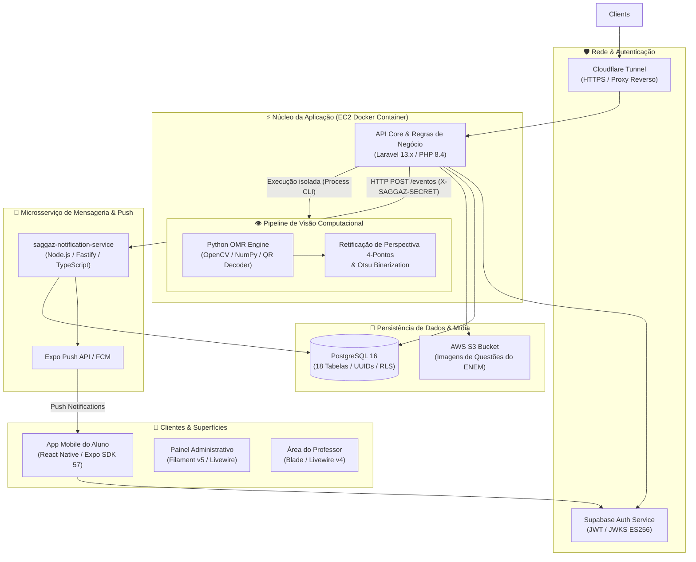
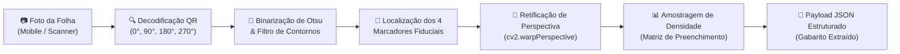

# 🎓 SAGGAZ — Automated Assessment & Computer Vision Grading Platform

<p align="center">
  
  
  
  
  
  
  
</p>

---

## 📌 1. Visão Geral e Problema Resolvido

A correção de avaliações escolares e simulados em larga escala enfrenta três gargalos críticos nas instituições de ensino:
1. **Custo temporal e sobrecarga docente:** Professores despendem dezenas de horas corrigindo manualmente centenas de folhas de prova, gerando atraso na entrega de feedbacks pedagógicos.
2. **Fragilidade operacional e fraudes:** Provas com ordem idêntica de questões facilitam a cópia entre estudantes, enquanto a transcrição manual de notas é suscetível a erros de digitação.
3. **Falta de visibilidade analítica em tempo real:** A ausência de consolidação imediata de dados impede a coordenação pedagógica de detectar lacunas de aprendizagem antes do término do bimestre.

### 💡 A Solução SAGGAZ
O **SAGGAZ** é uma plataforma ponta a ponta desenvolvida no Laboratório de Projeto Aplicado (CEFET-MG) que digitaliza e automatiza todo o ciclo avaliativo:
* **Banco de 2.757 Questões Oficiais:** Integração completa com histórico do ENEM e suporte a questões autorais com mídias em storage S3.
* **Geração Inteligente com Embaralhamento Idempotente:** Produção automatizada de cadernos de prova em PDF (ReportLab) com permutações de itens e QR Codes únicos por aluno.
* **Pipeline de Visão Computacional (OMR & QR):** Correção em **< 2 segundos por folha** via smartphone ou scanner, utilizando algoritmos de processamento de imagem (OpenCV, Otsu Thresholding, retificação de perspectiva via marcadores fiduciais e extração de densidade de preenchimento).
* **Distribuição Assíncrona de Resultados:** Notificações instantâneas via Push (Expo Push SDK / FCM) e portal analítico com métricas de turma e proficiência.

---

## 🏛️ 2. Arquitetura do Sistema

A arquitetura consolidada do SAGGAZ combina um **monólito modular de alto desempenho** para as regras de negócio e dashboards com **workers especializados de inferência e notificações assíncronas**, operando sob um banco relacional estritamente tipado.

### 📐 Diagrama Arquitetural de Alto Nível



### 🧠 Destaques de Engenharia & Decisão de Design (ADR)
* **Consolidação em Monólito Modular:** Inicialmente concebido com microserviços poliglotas e RabbitMQ, o projeto passou por uma refatoração orientada a métricas (ADR 2026-06), eliminando sobrecarga desnecessária de rede e latência.
* **Modelo de Dados com PK Compartilhada:** Herança relacional pura onde `admin`, `professor` e `aluno` compartilham o identificador `usuario_id` com a entidade raiz `usuario`. Todas as chaves primárias utilizam **UUIDv4**.
* **Zero Downtime & Segurança de Borda:** Tráfego de borda canalizado via **Cloudflare Zero Trust Tunnel**, eliminando necessidade de portas abertas na AWS EC2.

---

## 🔬 3. Pipeline de Visão Computacional (OMR & Leitura Óptica)

O motor de visão computacional em Python/OpenCV (`scripts/omr/leitor_omr.py`) opera em 5 estágios rigorosos para garantir precisão superior a 99,8% mesmo sob iluminação adversa e capturas inclinadas:



1. **Decodificação de QR Code Multi-Ângulo:** Tenta localizar o identificador da prova na orientação natural; se falhar, aplica rotações automáticas (90°, 180°, 270°) e downscaling dinâmico caso a imagem exceda 2000px.
2. **Localização de Marcadores Fiduciais:** Identifica os 4 quadrados fiduciais de canto calibrados por razão de aspecto ($0.75 \le \text{AR} \le 1.25$) e área percentual da folha A4.
3. **Transformação de Perspectiva Afim:** Calcula a matriz de homografia e projeta a folha em dimensões estritas de $1654 \times 2339\text{ px}$ (formato A4 a 150 DPI), anulando distorções de lente.
4. **Extração de Bolhas (OMR):** Percorre a grade de respostas calculando o índice de pixels pretos (fill ratio) em relação à área total de cada alternativa, descartando ruídos e marcas duplas.

---

## 🖥️ 4. Fluxos de Uso & Telas da Aplicação

### 1️⃣ Fluxo de Envio e Correção de Gabarito
1. O aluno abre o aplicativo móvel (`TelaAlunoSaggaz`) e posiciona a câmera sobre a folha de prova.
2. A aplicação faz o upload multipart da foto para `POST /api/correcao/omr` (ou via token previamente lido em `POST /api/correcao/{token}/omr`).
3. O backend executa o pipeline de Visão Computacional, confere a titularidade da versão (`versao_prova.aluno_id == aluno.usuario_id`) e calcula a pontuação.
4. Se o professor já tiver liberado os resultados (`resultados_liberados_em != null`), o aluno recebe o espelho completo com acertos e erros instantaneamente; caso contrário, a avaliação entra em estado `aguardando_liberacao`.

### 2️⃣ Fluxo de Autenticação & Autorização
* **Painel Administrativo (`/admin`):** Guard `web` do Laravel com checagem estrita de papel (`role = 'admin'`) em `Usuario::canAccessPanel()`.
* **Portal do Professor (`/professor`):** Middleware `EnsureProfessorAprovado` com verificação de vínculo institucional e turmas ativas.
* **App Mobile (`saggaz-aluno`):** Autenticação federada com **Supabase Auth** (`claims.sub` mapeado de forma idempotente para `aluno.usuario_id`), protegida por assinatura JWKS ES256 assimétrica.

### 3️⃣ Painéis & Dashboards
* Gestão macro das 18 entidades do schema acadêmico via Filament v5.
* Busca facetada por questões do ENEM filtrando por disciplina, ano e competências.
* Controle de liberação de notas com disparo assíncrono para a turma toda via Fastify Push Service.

---

## 📡 5. Documentação da API RESTful

Todas as rotas móveis exigem o cabeçalho de autenticação JWT e são limitadas por rate-limiting:
```http
Authorization: Bearer <supabase_access_token>
Content-Type: application/json
```

---

### `POST /api/correcao/omr`
Realiza a leitura óptica e correção direta de uma folha de respostas via arquivo de imagem ou string base64.

**Headers:**
* `Authorization: Bearer <token>`
* `Content-Type: multipart/form-data` (para arquivo) ou `application/json` (para base64)

**Body Parameters (Multipart ou JSON):**
| Campo | Tipo | Obrigatório | Descrição |
| :--- | :--- | :--- | :--- |
| `foto` | `File` | Opcional* | Arquivo de imagem (`jpg`, `jpeg`, `png`, `webp`, máx: 15MB). |
| `foto_base64` | `String` | Opcional* | Representação Base64 da imagem da folha (máx: 20MB). |

*\* Pelo menos um dos dois deve ser fornecido.*

#### Exemplo de Resposta de Sucesso (`200 OK` - Notas já liberadas)
```json
{
  "sucesso": true,
  "status": "respondida",
  "avaliacao": {
    "titulo": "Simulado 1º Bimestre - Ciências da Natureza",
    "token": "a1b2c3d4-e5f6-7890-abcd-ef1234567890",
    "total_questoes": 10,
    "acertos": 8,
    "nota": 8.0,
    "respostas": [
      { "numero": 1, "marcada": "A", "correta": "A", "acertou": true },
      { "numero": 2, "marcada": "C", "correta": "B", "acertou": false }
    ]
  }
}
```

#### Exemplo de Resposta (`200 OK` - Aguardando Liberação do Professor)
```json
{
  "sucesso": true,
  "status": "aguardando_liberacao",
  "mensagem": "Sua folha de respostas foi processada com sucesso. As notas serão exibidas assim que o professor liberar o gabarito oficial.",
  "protocolo": "98f4e12c-4e56-4211-b84a-9e120bc73a11"
}
```

#### Erros Comuns
| Código HTTP | Motivo | Exemplo de Retorno |
| :--- | :--- | :--- |
| `403 Forbidden` | Folha pertence a outro aluno. | `{"message": "Esta versão de prova não pertence ao seu usuário."}` |
| `422 Unprocessable` | Marcadores não legíveis ou QR ilegível. | `{"message": "Não foi possível ler o QR Code ou as marcações da folha. Certifique-se de que a foto está nítida."}` |

---

### `GET /api/correcao/{token}`
Obtém o estado atual da avaliação vinculada a um QR Code previamente escaneado.

**Parâmetros de Rota:**
* `token`: UUID identificador da `versao_prova`.

#### Resposta (`200 OK` - Avaliação Pendente)
```json
{
  "status": "pendente",
  "prova": {
    "titulo": "Avaliação de Matemática - 3º Ano A",
    "total_itens": 5,
    "questoes": [
      {
        "id": "c1f7b022-7cf2-4d08-a4e9-112233445566",
        "numero": 1,
        "enunciado": "Qual o valor da função para x = 4?",
        "alternativas": [
          { "id": "alt-01", "letra": "A", "texto": "16" },
          { "id": "alt-02", "letra": "B", "texto": "32" }
        ]
      }
    ]
  }
}
```

---

### `POST /api/correcao/{token}`
Submissão manual das respostas digitadas pelo aluno no aplicativo.

**Payload:**
```json
{
  "respostas": {
    "c1f7b022-7cf2-4d08-a4e9-112233445566": "alt-01",
    "d2a8c133-8df3-5e19-b5f0-223344556677": "alt-04"
  }
}
```

---

### `GET /api/aluno/provas`
Lista o histórico consolidado de todas as avaliações do aluno autenticado.

#### Resposta (`200 OK`)
```json
{
  "total": 3,
  "avaliacoes": [
    {
      "token": "a1b2c3d4-e5f6-7890-abcd-ef1234567890",
      "disciplina": "Física Geral",
      "data_aplicacao": "2026-10-15",
      "status": "respondida",
      "nota": 9.5
    },
    {
      "token": "f4e5d6c7-b8a9-0123-4567-89abcdef0123",
      "disciplina": "História do Brasil",
      "data_aplicacao": "2026-10-18",
      "status": "aguardando_liberacao",
      "nota": null
    }
  ]
}
```

---

### `POST /eventos` (Microsserviço Interno de Notificação)
Endpoint protegido por chave compartilhada (`X-SAGGAZ-SECRET`) consumido pelo Laravel ao liberar resultados.

```http
POST http://notificacoes:3001/eventos
X-SAGGAZ-SECRET: <INTERNAL_API_SECRET>
Content-Type: application/json
```

**Payload:**
```json
{
  "evento": "RESULTADOS_LIBERADOS",
  "turma_id": "turma-uuid-001",
  "prova_id": "prova-uuid-002",
  "titulo": "Resultados Liberados",
  "corpo": "As notas da prova de Biologia já estão disponíveis no aplicativo.",
  "dados": {
    "tela": "detalhes_prova",
    "prova_id": "prova-uuid-002"
  }
}
```

---

## 🚀 6. Como Executar a Demonstração Local

### Pré-requisitos
* **Docker Desktop** (com backend WSL2 no Windows).
* **Python 3.11+** com `opencv-python` e `numpy` para teste do leitor OMR.

```bash
# 1. Clonar este repositório vitrine
git clone https://github.com/ArthurMachado1/saggaz-showcase.git
cd saggaz-showcase

# 2. Executar o teste do motor de Visão Computacional (OMR)
python demo/omr_engine_demo.py --help
```

---

## 👨‍💻 Autor & Direitos

Projeto concebido e desenvolvido no **CEFET-MG (Campus Varginha)**.
* **Engenharia de Software, Modelagem Relacional & Visão Computacional:** Arthur Machado
* **Licença:** [MIT](LICENSE)
